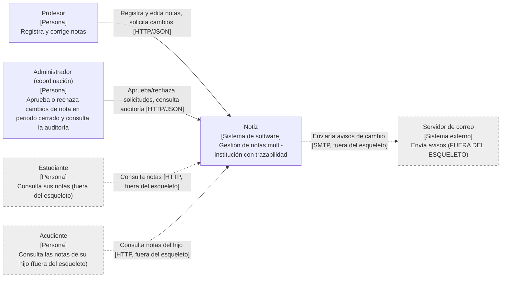
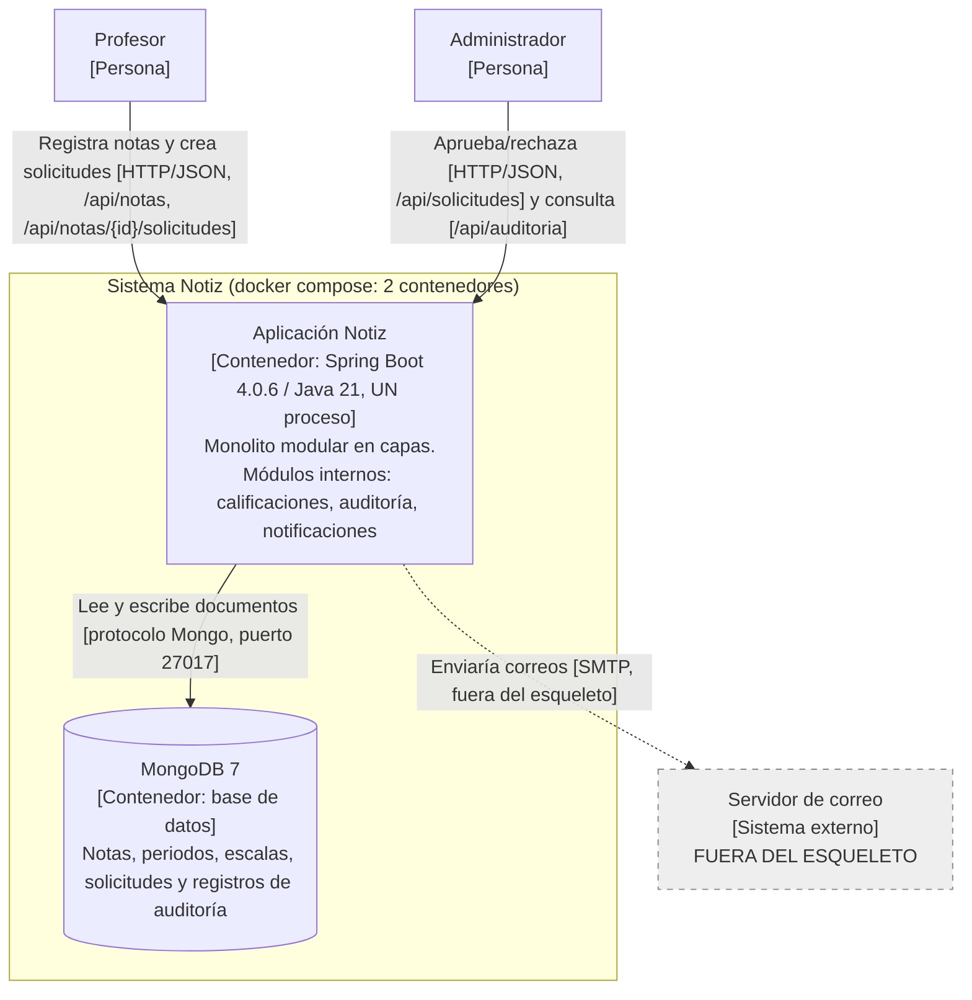
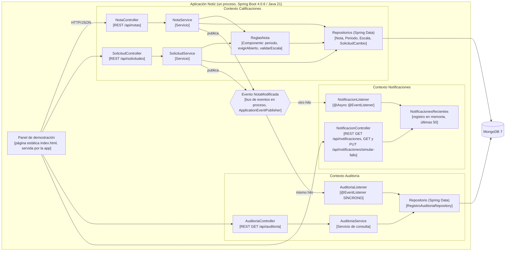

# 05 - Diagramas C4

> Los diagramas corresponden a `docker-compose.yml`: **2 contenedores (`app` y `mongo`)**. El monolito es UN solo proceso; los tres módulos internos NO son servicios separados.
> Versión para Structurizr: `Docs/c4/workspace.dsl`.

## Nivel 1 - Contexto del sistema

**Leyenda.** Caja: nombre, tipo entre corchetes, una línea de descripción. Flecha continua = interacción implementada en el esqueleto. Flecha y caja punteadas/grises = fuera del alcance del esqueleto. Texto de la flecha: verbo + medio/protocolo.

## Nivel 2 - Contenedores

**Leyenda.** Igual que el nivel 1, más: figura cilíndrica = base de datos; recuadro `Sistema Notiz` = frontera del sistema. Estudiante y Acudiente se omiten en este nivel (también en el DSL) porque no tienen interacción en el esqueleto.

El panel de demostración (`http://localhost:8080/`) NO es un contenedor nuevo: es una página estática que sirve la misma aplicación (`Notiz/src/main/resources/static/index.html`) y que solo llama a la API REST. Por eso este nivel sigue teniendo 2 contenedores.

**Correspondencia con el código.**

| Caja | Dónde está |
|---|---|
| Aplicación Notiz | `Notiz/` (Spring Boot, servicio `app` en `docker-compose.yml`); incluye el panel de demostración como recurso estático |
| MongoDB 7 | servicio `mongo` en `docker-compose.yml` |
| Servidor de correo | No existe: la notificación solo hace log `[NOTIFICACION] ...` y la anota en un registro en memoria |

## Nivel 3 - Componentes de la aplicación (OPCIONAL)

Leyenda: flecha punteada = asíncrono. Los tres contextos solo se conectan por el evento. El nodo `ev` (hexágono) NO es un contenedor ni un componente de código propio: representa el bus de eventos en proceso (`ApplicationEventPublisher` de Spring). En el DSL se modela como la descripción de la relación "publica NotaModificada (evento en memoria, ApplicationEventPublisher)" desde cada servicio hacia cada listener.

Notas de correspondencia con el código:

- `SolicitudService` NO llama a `NotaService`: usa `NotaRepository`, `SolicitudCambioRepository` y `ReglasNota`, y publica `NotaModificada` por su cuenta (al aprobar). `NotaService` también publica `NotaModificada` (al crear y editar).
- Las reglas de periodo y escala (`periodo`, `exigirAbierto`, `validarEscala`) viven en `ReglasNota`, que usan ambos servicios.
- Auditoría: `AuditoriaController` -> `AuditoriaService` -> `RegistroAuditoriaRepository` -> MongoDB. `AuditoriaListener` escribe con el mismo repositorio.
- Los repositorios se dibujan como un solo componente "Repositorios (Spring Data)" por contexto para mantener legible el diagrama.
- Componentes de apoyo no dibujados: `ManejadorErrores` (`@RestControllerAdvice`: `ReglaNegocioException` y validación de entrada -> 400, `NoEncontradoException` -> 404), `NotaDtos` (DTOs de entrada/salida de los controllers) y `DatosIniciales` (`CommandLineRunner` que carga la escala `E1`, el periodo `P1` cerrado, el periodo `P2` abierto y la nota `N1` = 2.8).
- La asincronía de `NotificacionListener` solo funciona porque `NotizApplication` tiene `@EnableAsync`.
- Notificaciones: `NotificacionListener` escribe cada resultado (`ENVIADA` o `FALLIDA`, con el nombre del hilo) en `NotificacionesRecientes`, un registro en memoria acotado a 50 entradas; `NotificacionController` lo consulta y controla el interruptor `SimulacionFallo` (control de demostración). Solo conoce de Calificaciones el evento `NotaModificada`.
- El panel de demostración es un recurso estático de la misma aplicación (no un contenedor). En el diagrama se dibujan solo sus llamadas principales; también usa `GET /api/periodos` (`PeriodoController`, en Calificaciones).

## Fuera del esqueleto (no dibujado como caja)

Login/OAuth2/JWT (seguridad), foros, chat, horarios, reportes, boletines PDF, carga masiva, multitenancy real, SendGrid y Redis (existían como stubs en la etiqueta `andamiaje-original`).
